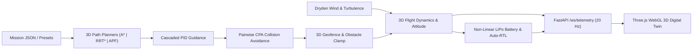

# SwarmForge — Multi-UAV 3D Digital Twin & Autonomous Mission Planner

> **SAFETY NOTICE — SIMULATION ONLY (`HARDWARE_ACTUATION_LOCKED = True`)**
> SwarmForge is an isolated software Digital Twin. Physical hardware actuation, motor arming, and outbound flight-controller commands are permanently disabled in code (`backend/sim_engine/safety.py`) and blocked at the API layer (`/api/hardware/actuate` returns **HTTP 403 Forbidden**).

SwarmForge is a full-stack multi-drone autonomous mission planning and 3D flight physics simulation platform built with **FastAPI**, **WebSockets**, **NumPy**, **Pydantic v2**, **React + TypeScript**, and **Three.js / React Three Fiber**.



---

## Key Capabilities

### 1. Quantitative 3D Path Planning & Comparison Engine
Implemented in [`backend/sim_engine/path_planners.py`](backend/sim_engine/path_planners.py):
- **3D A\* Voxel Grid + LOS Smoothing**: Vectorized 3D Euclidean-distance occupancy grid, 26-connected search with corner-clipping prevention, Euclidean heuristic, and multi-pass Line-of-Sight (LOS) shortcutting.
- **3D RRT\***: Seeded 3D sampling with nearest-neighbor steering, minimum-cost parent selection, asymptotic rewiring within `rewire_radius_m`, and continuous segment clearance checks.
- **3D Artificial Potential Field (APF)**: Attractive goal field + inverse-square obstacle repulsion + tangential curl & local-minimum detector to skirt around wide structures without deadlocking, simplified safely via collision-checked Douglas-Peucker reduction.

#### Observed Benchmark Results (`urban_corridor` skyline, start `[-62, -52, 18]` → goal `[58, 48, 24]`, clearance `2.5 m`)

| Algorithm | Success | Path Length (m) | Compute Time (ms) | Smoothness (rad) | Min Clearance (m) | Est. Energy (Wh) | Waypoints |
|---|---:|---:|---:|---:|---:|---:|---:|
| **3D A\* + LOS** | PASS | **168.44 m** | 176.07 ms | **0.893 rad** | 2.52 m | **1.529 Wh** | 5 |
| **3D RRT\*** | PASS | 180.57 m | 211.69 ms | 5.092 rad | 2.97 m | 1.584 Wh | 14 |
| **3D APF** | PASS | 190.47 m | **33.24 ms** | 24.269 rad | **3.14 m** | 2.020 Wh | 25 |

> *Values measured directly from `compare_planners()` on `backend/sample_missions/urban_corridor.json` (`seed=42`).*

### 2. Multi-UAV Flight Physics, Dryden Wind & LiPo Battery Model
Implemented in [`backend/sim_engine/uav_dynamics.py`](backend/sim_engine/uav_dynamics.py):
- **Cascaded PID Guidance**: Outer-loop 3D waypoint/hold/RTL guidance feeding an inner-loop anti-windup velocity PID ($\mathbf{a}_{\text{cmd}}$) integrated at `dt = 0.05 s`.
- **Attitude Estimation**: Derives body roll, pitch, and yaw ($\phi, \theta, \psi$) from specific thrust vector $\mathbf{T} = \mathbf{a}_{\text{cmd}} + [0, 0, g]^T$ projected into the yaw-aligned frame.
- **Dryden-like Wind & Turbulence**: Combines a steady 3D wind vector with an exponentially correlated 1st-order Gauss-Markov turbulence filter ($\tau = 1 / 2\pi f_{\text{gust}}$) and quadratic aerodynamic drag.
- **Non-Linear LiPo Battery Model**:
  $$P(t) = P_{\text{hover}} + k_{\text{drag}} v_{\text{air}}^3 + k_{\text{accel}} m \|\mathbf{a}_{\text{cmd}}\|^2 + P_{\text{climb}}(v_z)$$
  Models non-linear open-circuit voltage (OCV vs. SoC), load-dependent internal-resistance voltage sag ($V_{\text{term}} = V_{\text{oc}} - I R_{\text{int}}$), and automatic `LOW_BATTERY_AUTO_RTL` transition at `rtl_soc_threshold_pct`.

### 3. Safety Systems & Failsafes
Implemented in [`backend/sim_engine/safety.py`](backend/sim_engine/safety.py):
- **Pairwise Collision Avoidance**: Closest-Point-of-Approach (CPA) prediction + reciprocal repulsive velocity blending + starboard tangential swirl & vertical stagger.
- **3D Cylindrical, Polygonal & Altitude Geofencing**: Progressive soft braking inside `soft_margin_m` + hard coordinate clamp at boundaries (`radius_m`, optional `polygon_xy`, `min_altitude_m`, `max_altitude_m`).
- **Communication-Loss & Emergency Handling**: Simulated GCS link drop automatically engages `COMM_LOSS_HOLD` or `COMM_LOSS_RTL`; global `Emergency RTL` and `Emergency Land` triggers.

---

## Project Structure

```text
03-SWARMFORGE/
├── backend/
│   ├── main.py                    # FastAPI REST + /ws/telemetry WebSocket + UI server
│   ├── sim_engine/
│   │   ├── models.py              # Pydantic v2 schemas
│   │   ├── path_planners.py       # 3D A*, RRT*, APF + compare_planners()
│   │   ├── uav_dynamics.py        # PID, attitude, Dryden wind, non-linear battery
│   │   ├── safety.py              # HARDWARE_ACTUATION_LOCKED, CA, geofence, failsafes
│   │   └── simulator.py           # Thread-safe SwarmSimulator coordinator
│   ├── sample_missions/           # Importable/exportable JSON mission templates
│   └── static/index.html          # Zero-build Three.js WebGL (+ Canvas3D fallback) UI
├── frontend/                      # Full React 18 + TypeScript + Vite + React Three Fiber source
│   ├── package.json
│   ├── tsconfig.json
│   └── src/
├── tests/                         # Pytest verification suite
├── docs/ARCHITECTURE.md
├── ROADMAP.md
├── requirements.txt
└── pyproject.toml
```

---

## Quickstart

### 1. Install Python Dependencies & Launch Digital Twin
```bash
pip install -r requirements.txt
uvicorn backend.main:app --host 127.0.0.1 --port 8000 --reload
```
Open **`http://127.0.0.1:8000/`** in your browser to launch the interactive 3D Digital Twin UI immediately.

### 2. Run the React + TypeScript Frontend (Optional Dev Server)
```bash
cd frontend
npm install
npm run dev
```
Vite proxies `/api` and `/ws` directly to `http://127.0.0.1:8000`.

### 3. Run Verification Tests
```bash
python -m pytest tests -v
```

---

## REST & WebSocket API Highlights

- `GET /` — Interactive 3D WebGL Digital Twin UI
- `GET /health` — Service health & `hardware_actuation_locked: true`
- `WS /ws/telemetry` — Live 20 Hz `TelemetryFrame` stream & JSON control commands
- `GET /api/missions` — List sample missions (`urban_corridor`, `head_on_crossing`, `sar_perimeter_high_wind`)
- `POST /api/missions/load` — Load preset by `mission_id` or import full `MissionConfig` JSON
- `GET /api/missions/export` — Export active mission JSON
- `POST /api/planners/compare` — Benchmark A*, RRT*, and APF side-by-side
- `POST /api/simulation/{start,pause,reset,step,wind,comm-loss,emergency,planner}` — Live simulation control
- `POST /api/hardware/actuate` — Permanently returns `HTTP 403` (`HARDWARE_ACTUATION_LOCKED = True`)

## License
MIT — see [LICENSE](LICENSE).
