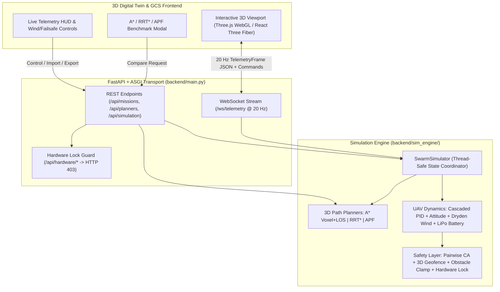

# SwarmForge Architecture (`swarmforge-uav-simulator`)

## 1. System Overview & Module Boundaries

SwarmForge is organized as a deterministic, simulation-only multi-UAV Digital Twin separating planning, flight dynamics, safety enforcement, and real-time visualization across strict module boundaries:



## 2. Coordinate Frames

- **Simulation Frame (ENU — East-North-Up, meters)**:
  - $+X$: East
  - $+Y$: North
  - $+Z$: Altitude AGL (Above Ground Level, $Z \ge 0$)
- **Three.js Rendering Frame (Y-Up)**:
  - $\mathbf{p}_{\text{Three}} = (X_{\text{ENU}},\; Z_{\text{ENU}},\; -Y_{\text{ENU}})$
  - Ensures right-handed consistency between North/East ground layouts and vertical buildings.

## 3. Simulation Tick Pipeline (`dt = 0.05 s`)

```mermaid
sequenceDiagram
    participant Loop as Async Loop / Step API
    participant Wind as DrydenWindModel
    participant Guide as Guidance Outer Loop
    participant CA as Pairwise Collision Avoidance
    participant Obs as Obstacle & Geofence Shield
    participant PID as Velocity PID + Euler Integrator
    participant Bat as Non-Linear LiPo Battery Model

    Loop->>Wind: step(dt_s) -> w(t) = w_steady + w_turb(t)
    Loop->>Guide: Compute v_desired per UAV mode (MISSION/HOLD/RTL/COMM_LOSS)
    Guide->>CA: CPA + reciprocal repulsive velocity blending
    CA->>Obs: Reactive obstacle repulsion + soft geofence braking
    Obs->>PID: v_safe -> PID accel command + quadratic aero drag
    PID->>Obs: Post-integration hard obstacle & 3D geofence clamp
    PID->>Bat: Integrate power(v_air, a_cmd, climb) -> SoC%, V_term sag, Auto-RTL check
```

## 4. Safety Architecture & Hardware Interlock

SwarmForge implements defense-in-depth safety inside `backend/sim_engine/safety.py`:

1. **Permanent Hardware Interlock (`HARDWARE_ACTUATION_LOCKED = True`)**:
   - `assert_hardware_actuation_locked()` raises `HardwareActuationBlockedError`.
   - REST endpoints `/api/hardware/actuate` and `/api/hardware/arm` unconditionally reject actuation requests with HTTP `403 Forbidden`.
2. **Multi-Agent Pairwise Collision Avoidance**:
   - Evaluates pairwise separation $d_{ij}$ and Closest Point of Approach (CPA) miss distance over a `3.0 s` lookahead horizon.
   - Blends reciprocal repulsive separation, closing-velocity cancellation, and right-hand starboard tangential swirl + vertical stagger to prevent head-on deadlocks.
3. **3D Cylindrical / Polygonal & Altitude Geofencing**:
   - Soft braking within `soft_margin_m` (progressive outward velocity attenuation + warning flag).
   - Hard boundary clamp at `radius_m`, optional `polygon_xy` edges, `min_altitude_m`, and `max_altitude_m`.
4. **Autonomous Comm-Loss & Emergency Modes**:
   - Link drop immediately transitions UAVs to `COMM_LOSS_HOLD` (wind-compensated hover anchor) or `COMM_LOSS_RTL` (climb to safe transit altitude, return home, descend and land).

## 5. API & WebSocket Contract

| Interface | Endpoint | Direction | Purpose |
|---|---|---|---|
| Web UI | `GET /` | Server -> Browser | Serves interactive 3D WebGL Digital Twin |
| Health | `GET /health` | Server -> Client | Liveness + `hardware_actuation_locked: true` |
| Telemetry Stream | `WS /ws/telemetry` | Bidirectional | Live 20 Hz `TelemetryFrame` + JSON commands |
| Missions | `GET /api/missions`, `POST /api/missions/load`, `GET /api/missions/export` | REST JSON | Preset templates & mission JSON import/export |
| Planners | `POST /api/planners/compare`, `POST /api/planners/plan` | REST JSON | 3D A* / RRT* / APF planning & quantitative metrics |
| Controls | `POST /api/simulation/{start,pause,reset,step,wind,comm-loss,emergency,planner}` | REST JSON | Live simulation manipulation |
| Safety Guard | `POST /api/hardware/actuate`, `POST /api/hardware/arm` | REST JSON | Always returns HTTP `403` |
